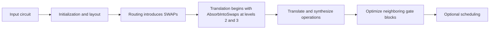
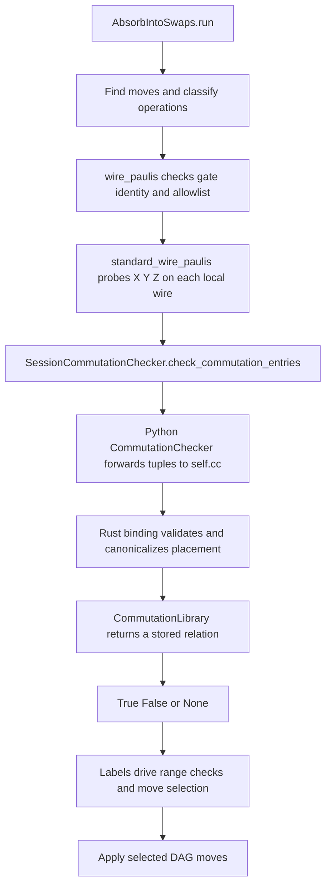

# Understanding swap absorption and commutation checking in Qiskit

`_swap_absorption.py` rearranges a quantum circuit so that a two-qubit interaction sits immediately beside a SWAP on the same two qubits. Later compiler passes can synthesize the neighboring operations together, sometimes using fewer hardware gates. The rearrangement preserves the circuit's operation, including its global phase.

The central idea is **move an interaction through gates that commute with it, stopping beside the SWAP**. The pass obtains the rules for those moves through `CommutationChecker.check_commutation_entries()`. It uses stored rules about gate families and qubit placement, rather than the checker's general numerical commutation test.

This guide describes the working-tree implementation dated 23 October 2026, including the repaired raw lookup API. The leading underscores in `_swap_absorption.py` and `_AbsorbIntoSwaps` indicate implementation details rather than a stable public API.

Read the background first if quantum circuits are new to you. The later sections follow the code from gate classification through candidate selection to the final DAG rewrite.

## Reading map

1. [Quantum background](#quantum-background)
2. [Qiskit compiler background](#qiskit-compiler-background)
3. [Why putting a gate beside a SWAP helps](#why-putting-a-gate-beside-a-swap-helps)
4. [The relationship between the source files](#the-relationship-between-the-source-files)
5. [How the pass proves that a move is safe](#how-the-pass-proves-that-a-move-is-safe)
6. [How CommutationChecker supplies the rules](#how-commutationchecker-supplies-the-rules)
7. [Walking through the swap absorption implementation](#walking-through-the-swap-absorption-implementation)
8. [Tracing one complete example](#tracing-one-complete-example)
9. [Examples of allowed and blocked moves](#examples-of-allowed-and-blocked-moves)
10. [Running and checking the examples](#running-and-checking-the-examples)
11. [What the tests establish](#what-the-tests-establish)
12. [Performance and implementation boundaries](#performance-and-implementation-boundaries)
13. [Glossary and source map](#glossary-and-source-map)

## Quantum background

### Qubits and states

A classical bit holds either `0` or `1`. A qubit has a state that can be written as

```text
|ψ⟩ = α|0⟩ + β|1⟩,     |α|² + |β|² = 1.
```

The notation `|ψ⟩` means a state vector. The complex numbers `α` and `β` are amplitudes. Measuring in the computational basis produces `0` with probability `|α|²` and `1` with probability `|β|²`.

The amplitudes also have phases. Two states can have the same immediate measurement probabilities but respond differently to later gates because their relative phases differ. A compiler therefore has to preserve more than the probabilities of one measurement at one point.

For two qubits, there are four computational basis states; for `n` qubits, there are `2ⁿ`. Some multi-qubit states are **entangled**: their joint state cannot be described by assigning each qubit its own independent state. This is one reason circuit correctness is checked using the operation on the whole system.

### Gates as matrices

A quantum gate is a reversible linear transformation of the state. Its matrix `U` is **unitary**, meaning `U†U = I`. Here `†` means conjugate transpose and `I` is the identity operation.

A one-qubit gate has a `2 × 2` matrix. A two-qubit gate has a `4 × 4` matrix. Applying a gate changes the state to `U|ψ⟩`.

Circuit instructions are written in execution order. If a circuit executes `A` and then `B`, its matrix is `BA`: the rightmost matrix acts first. In this guide, semicolon-separated sequences such as `A; B` always mean execution order.

The **tensor product**, written `⊗`, combines operations on different qubits. For example, `A ⊗ I` applies `A` to one factor of a two-qubit state and leaves the other alone. To avoid ordering ambiguity, expressions such as `Z_a` mean “Z acting on qubit a, with identity on the other qubits.”

### The gates that matter here

| Gate | Meaning | Relevance to this pass |
| --- | --- | --- |
| `X` | Exchanges `\|0⟩` and `\|1⟩`. | One of the three Pauli probes. |
| `Y` | Exchanges the basis states with complex phase factors. | Another Pauli probe and the axis for Y rotations. |
| `Z` | Leaves `\|0⟩` unchanged and multiplies `\|1⟩` by `−1`. | The probe for computational-basis diagonal gates. |
| `H` | Maps `\|0⟩` to `(\|0⟩ + \|1⟩)/√2`, and `\|1⟩` to `(\|0⟩ − \|1⟩)/√2`. | A common gate that this pass treats as a blocker. |
| `RX(θ)`, `RY(θ)`, `RZ(θ)` | Rotations generated by X, Y, or Z. | Their family determines the local commutation label. |
| `P(θ)` | Multiplies `\|1⟩` by `exp(iθ)`. | A diagonal phase gate; `U1` is its legacy counterpart. |
| `CX(a,b)` | Applies X to target `b` when control `a` is `1`. | Can be moved using different rules on its control and target. |
| `CZ(a,b)` | Multiplies the joint `11` basis state by `−1`. | Diagonal on both qubits. |
| `CP(θ,a,b)` | Multiplies the joint `11` basis state by `exp(iθ)`. | A typical interaction to move next to a SWAP. |
| `RZZ(θ,a,b)` | `exp(−iθ Z_a Z_b / 2)`. | An interaction diagonal in both Z bases. |
| `SWAP(a,b)` | Exchanges the quantum information held by `a` and `b`. | The destination beside which the pass places an interaction. |

The Pauli matrices are

```text
X = [0  1]     Y = [0 −i]     Z = [1  0]
    [1  0]         [i  0]         [0 −1]
```

They satisfy `X² = Y² = Z² = I`. For any one of these matrices `P`,

```text
RP(θ) = exp(−iθP/2) = cos(θ/2) I − i sin(θ/2) P.
```

This equation will explain why the code can use X as a proof representative for an entire RX family.

A **diagonal** matrix has zero entries outside its main diagonal. A diagonal unitary changes basis-state phases without mixing the basis states. Two matrices diagonal in the same basis commute.

### Commutation and exact reordering

Two gates commute exactly if

```text
AB = BA.
```

Their execution order can then be exchanged without changing the circuit's matrix. Examples include two Z rotations on one qubit, a Z rotation on the control of a CX, and an X rotation on its target.

Gates acting on disjoint sets of qubits commute as quantum operators. Gates sharing a qubit require more care: an RZ on the target of a CX generally cannot be moved through that CX.

For a concrete counterexample, `XZ = −ZX`. Exchanging X and Z changes the overall matrix by a phase. That is different from exact equality.

A **global phase** multiplies the entire state by the same factor `exp(iφ)` and does not change ordinary measurement probabilities. Numerical equivalence tests may ignore global phase. This pass uses exact commutation identities and preserves the phase as well; that stronger property is useful when circuits become parts of larger constructions.

### Qubit order has two meanings

In `qc.cx(0, 1)`, qubit 0 is the control and qubit 1 is the target. The ordered argument list is called `qargs`. This pass's label `"ZX"` means **Z on `qargs[0]`, X on `qargs[1]`**.

Qiskit's state strings and matrix tensor factors use a different display convention: qubit 0 is the least significant bit, so two-qubit states are written `|q1 q0⟩`. Circuit diagrams normally draw qubit 0 at the top. These conventions are described in [IBM's bit-ordering guide](https://quantum.cloud.ibm.com/docs/en/guides/bit-ordering).

In particular, the pass's `"ZX"` label is a list in argument order, not a Qiskit `Pauli("ZX")` string. For `RZX(θ, 0, 1)`, the local action is Z on qubit 0 and X on qubit 1; its matrix generator is written `X ⊗ Z` in Qiskit's tensor order. See the local [RZX implementation](../qiskit/circuit/library/standard_gates/rzx.py).

## Qiskit compiler background

### Circuits and hardware connectivity

`QuantumCircuit` is Qiskit's representation of a program containing quantum gates and other instructions, such as measurement and reset. For example:

```python
from qiskit import QuantumCircuit

qc = QuantumCircuit(3)
qc.h(0)
qc.cx(0, 2)
```

The program can request an interaction between qubits 0 and 2 even if a device only supports interactions along a line:

```text
physical qubit 0 ─── physical qubit 1 ─── physical qubit 2
```

The compiler must arrange for the quantum information involved in each interaction to occupy connected physical qubits. A **layout** assigns logical circuit qubits to physical device qubits. **Routing** inserts SWAPs to change where that information resides as the program proceeds. A **coupling map** describes the allowed connections. A **Target** describes supported instructions and their hardware constraints.

### Transpilation and passes

Qiskit calls circuit compilation **transpilation**. A pass is one analysis or transformation inside that process. A `PassManager` runs passes in sequence, and a preset pass manager assembles a pipeline according to options such as the optimization level.

The conceptual stages are initialization, layout, routing, translation, optimization, and scheduling. Translation expresses instructions in the device's supported gate set; optimization simplifies their implementation; scheduling assigns execution times. See [IBM's transpiler stages guide](https://quantum.cloud.ibm.com/docs/en/guides/transpiler-stages) for the general pipeline.

In this checkout, [generate_translation_passmanager](../qiskit/transpiler/preset_passmanagers/common.py) prepends `_AbsorbIntoSwaps()` when `optimization_level` is 2 or 3. Levels 0 and 1, and the helper's default value `None`, do not add it. Both built-in translation builders pass their optimization level to this helper.



The pass needs to see SWAPs while they still appear as individual operations. Subsequent block optimization can combine the relocated interaction with the SWAP or its translated implementation. The precise collection and synthesis passes depend on the selected pipeline; the synthesis translation method also collects and synthesizes two-qubit blocks during translation itself.

### Why the code works with a DAG

A **DAG**, or directed acyclic graph, records operations and the ordering constraints between them. In a `DAGCircuit`, a `DAGOpNode` contains an operation together with its quantum and classical arguments.

An operation using two qubits belongs to the paths of both wires. Operations on unrelated wires may have no dependency between them. A **topological order** lists nodes while respecting all graph dependencies, but unrelated nodes can have several valid orders.

That distinction matters here: “next to a SWAP” means adjacent **on both participating wires**. It does not require neighboring positions in a flattened instruction list; unrelated work on a third qubit may appear between them in such a list.

`_AbsorbIntoSwaps` inherits from `TransformationPass` because it changes the DAG. An `AnalysisPass`, by contrast, computes information for other passes.

## Why putting a gate beside a SWAP helps

A SWAP can be decomposed into three CX gates:

```text
SWAP(a,b) = CX(a,b); CX(b,a); CX(a,b)
```

Now append `CX(a,b)`:

```text
SWAP(a,b); CX(a,b)

    = CX(a,b); CX(b,a); CX(a,b); CX(a,b)
    = CX(a,b); CX(b,a)
```

The final two CX operations cancel because applying the same CX twice gives identity. Treating the SWAP and interaction independently would suggest four CX operations; treating them together needs only two in this example.

Other interactions can also benefit from joint synthesis, but the reduction depends on the interaction, target gates, and synthesis settings. The pass does not calculate a saving for every candidate.

Consider this sequence:

```text
SWAP(0,1); RZ(0.2,0); CP(0.3,0,1); later two-qubit work
```

RZ and CP are diagonal, so the pass can produce:

```text
SWAP(0,1); CP(0.3,0,1); RZ(0.2,0); later two-qubit work
```

The interaction now sits beside the SWAP. `_AbsorbIntoSwaps` itself retains both operations and the original operation count. Later synthesis is responsible for any reduction in hardware gates.

The CP remains after the SWAP. Likewise, an interaction originally before a SWAP is moved to immediately before it. Commuting **through the SWAP** is unnecessary and can be wrong for asymmetric interactions such as CRZ.

## The relationship between the source files

The path from the pass to the commutation table is:



| File | Responsibility |
| --- | --- |
| [_swap_absorption.py](../qiskit/transpiler/preset_passmanagers/_swap_absorption.py) | Defines supported operations, derives local labels, searches for moves, and rewrites the DAG. |
| [commutation_library.py](../qiskit/circuit/commutation_library.py) | Creates the shared `SessionCommutationChecker` and equips it with the standard Rust table. |
| [commutation_checker.py](../qiskit/circuit/commutation_checker.py) | Public Python API and forwarding to the Rust checker stored in `self.cc`. |
| [commutation_checker.rs](../crates/transpiler/src/commutation_checker.rs) | Implements the raw lookup binding, table storage, and the broader commutation algorithms. |
| [standard_gates_commutations.rs](../crates/transpiler/src/standard_gates_commutations.rs) | Supplies the standard table used by the shared checker. |

The pass imports `SessionCommutationChecker` from `commutation_library.py`; it does not directly import the `CommutationChecker` class. The session object is nevertheless an instance of that Python class.

A fresh `CommutationChecker()` has an empty configured table in this implementation. `commutation_library.py` creates that wrapper and then replaces its `.cc` with `get_standard_commutation_checker()`, giving the session object the standard table. This distinction matters when trying lookup examples interactively.

## How the pass proves that a move is safe

### A letter describes a local commutation property

For each admitted operation, the pass assigns one character per qubit argument:

| Character | Meaning |
| --- | --- |
| `X` | The operation commutes exactly with X applied to this wire. |
| `Y` | It commutes exactly with Y on this wire. |
| `Z` | It commutes exactly with Z on this wire. |
| `-` | This classification provides no usable proof for this wire. |

**For a two-qubit gate, the two letters correspond to the first and second qubits in the gate's argument list.** Each letter describes what the whole gate commutes with on that qubit.

For a gate acting on `(q0, q1)`, the label **`ZZ`** means:

- First `Z`: the gate commutes with a Z operation on `q0`.
- Second `Z`: the gate commutes with a Z operation on `q1`.

Either of those single-qubit Z operations can therefore move before or after the gate without changing the circuit's behavior. For example, if `G(q0, q1)` has label `ZZ`, these execution sequences are equivalent:

```text
Z(q0); G(q0, q1)  =  G(q0, q1); Z(q0)
Z(q1); G(q0, q1)  =  G(q0, q1); Z(q1)
```

**`ZZ` does not mean that the gate applies two Z gates.** For example, `CP(θ, q0, q1)` is a controlled-phase gate, but its label is `ZZ`. The label describes its commutation properties; the gate can still entangle the two qubits.

Similarly, `CX(control, target)` has label **`ZX`**: it commutes with Z on its control and X on its target. The letter positions follow argument order, even when the qubits are supplied in a different numerical order.

**The movement rule is that the candidate and every crossed unit must have the same non-dash label on each shared wire.** Wires not shared by the two operations do not need a comparison.

Suppose a `CX(a,b)` must cross `CX(a,c)`. They share only `a`, and both have Z there, so the rule permits it. For `CX(a,b)` crossing `CX(b,c)`, the shared wire `b` has X in the first operation and Z in the second, so the rule rejects it.

### Why matching local letters is sufficient

For a Pauli `P`, its two eigenvalues are `+1` and `−1`; the associated projectors are

```text
Π+ = (I + P)/2,     Π− = (I − P)/2.
```

A projector selects the component of a state in one of those eigenspaces. An operation commuting with the local Pauli preserves these eigenspaces: it is block diagonal in that wire's Pauli eigenbasis.

If two operations commute with the same local Pauli on **every shared wire**, choose those bases on the shared wires. Within each shared-basis sector, their remaining actions are on disjoint sets of private wires. Those actions commute, and therefore the two full operations commute exactly.

The requirement “every shared wire” is essential. Merely sharing one conserved Pauli somewhere does not prove that two arbitrary multi-qubit operations commute.

This is a sufficient test, not a complete classification of commuting gates. For example, `X_a X_b` and `Z_a Z_b` commute because two minus signs cancel, even though their local letters differ on both wires. The pass deliberately does not exploit that broader pattern.

### How the three constants work together

The pass first needs a short description of how each gate commutes with operations on its qubits. For example, it wants to record `Z` for an RZ gate, `ZZ` for a CP gate, and `ZX` for a CX gate. Later, the search compares these letters to decide which gates an interaction can cross.

The three constants help **compute that description**. They do not directly move gates. Start by distinguishing the original gate, the operation used to consult the table, and the operations used for comparison:

| Role | In an example with `CP(0.3, a, b)` |
| --- | --- |
| Original gate | `CP(0.3)` acting on circuit qubits `a` and `b`. This is the gate whose behavior must be preserved. |
| Lookup representative | `CZGate()`. Its stored commutation rules supply the proof needed for this CP family. |
| Probe | One of `XGate()`, `YGate()`, or `ZGate()`, considered on one qubit at a time. |
| Computed label | `"ZZ"`, recorded for the original CP gate. |

**CZ and the probes exist only in the classification process. The circuit still contains `CP(0.3, a, b)`.** In particular, CP is not being replaced with CZ, and the probes are not added to the circuit.

#### First decide whether this gate family is admitted

`_SUPPORTED_GATES` is a `frozenset`: a collection of names that cannot be changed in place. The code uses it for membership checks such as:

```python
"rz" in _SUPPORTED_GATES  # True
"cp" in _SUPPORTED_GATES  # True
"cx" in _SUPPORTED_GATES  # True
"h" in _SUPPORTED_GATES   # False
```

The set answers only whether this pass admits a standard gate family for table-based classification. It does not store labels or commutation answers. A **gate family** means operations with the same gate type but potentially different parameters: `RZ(0.2)` and `RZ(0.8)` belong to the RZ family, whose name is `"rz"`.

`_wire_paulis` first verifies that the node is a recognized standard gate. It then checks its name against this set. This order prevents a custom gate merely named `"rz"` from inheriting the standard RZ rules.

A standard H gate fails the membership check and receives `"-"` immediately. There are no representative or probe lookups for it. Even if the shared commutation table knows something about H, this pass has explicitly excluded that family.

Being in `_SUPPORTED_GATES` permits classification; it does not guarantee a move. One-qubit families appear here because the search must classify gates that a moving two-qubit interaction would cross. SWAP is handled separately as a destination and remains a blocker for crossing.

#### Then choose which operation to look up

`_LOOKUP_REPRESENTATIVES` is a dictionary. Its keys are original gate names, and its values are gate objects to use in the table query. For example:

```text
original name "rz"  →  use ZGate() for lookup
original name "cp"  →  use CZGate() for lookup
```

This adapter matters because the raw lookup only retrieves stored entries. It does not automatically translate RZ into Z or CP into CZ. The current [standard Rust table](../crates/transpiler/src/standard_gates_commutations.rs) contains entries for `"z"` and `"cz"`, while `"rz"` and `"cp"` have no entries of their own. Without the adapter, raw queries using those original names would return `None` and fail to produce their labels.

The selection is performed by this line:

```python
representative = _LOOKUP_REPRESENTATIVES.get(op.name, op)
```

Python's `dictionary.get(key, default)` returns the dictionary's value if the key exists, otherwise it returns `default`. Here that default is the original operation `op`:

| Original operation | Dictionary entry exists? | Selected representative |
| --- | --- | --- |
| `RZGate(0.2)` | Yes, under `"rz"`. | `ZGate()` |
| `CPhaseGate(0.3)` | Yes, under `"cp"`. | `CZGate()` |
| `CXGate()` | No. | The original `CXGate()` |
| `RZZGate(0.4)` | No. | The original `RZZGate(0.4)` |

**A missing representative entry means “use the original gate,” not “reject the gate.”** Admission is the separate job of `_SUPPORTED_GATES`. This is why the two collections have different sizes and different contents.

The representative must justify the rule for the original gate's whole family. It is not an arbitrary substitute with a similar name. For RZ, both Z and every RZ rotation act diagonally in the same basis:

| Input state | Z produces | RZ with angle θ produces |
| --- | --- | --- |
| `\|0⟩` | `\|0⟩` | `exp(−iθ/2)\|0⟩` |
| `\|1⟩` | `−\|1⟩` | `exp(iθ/2)\|1⟩` |

Their phase factors differ, so these are generally different gates. But RZ can always be written as

```text
RZ(θ) = cos(θ/2) I − i sin(θ/2) Z.
```

This is the identity matrix multiplied by one number, plus Z multiplied by another. If a probe `P` commutes with Z, it also commutes with that sum: it commutes with identity, and moving it past Z changes nothing. Thus a positive rule for the representative proves the needed rule for every RZ angle.

The implication is one-way: a positive representative result supplies a family-wide proof. A negative result need not exclude special angles. At angle zero, RZ is identity and commutes with everything, but this pass still uses the family label `Z`.

#### Compare the selected operation with the three probes

`_PAULI_PROBES` is a tuple of three pairs:

```python
_PAULI_PROBES = (("X", XGate()), ("Y", YGate()), ("Z", ZGate()))
```

Each pair contains two different kinds of object:

| Part of `("Z", ZGate())` | Purpose |
| --- | --- |
| `"Z"`, a string | The letter to retain if this probe gives the one positive answer for the current qubit. |
| `ZGate()`, a gate object | The operation passed to the checker to ask the commutation question. |

The same three probes are used for every admitted family. They are not the complete list of supported circuit gates. Their role is to ask three fixed questions about each qubit of the chosen representative.

The checker receives two operations and the qubits on which each acts:

```text
check_commutation_entries(
    representative, qubits_of_the_representative,
    probe,          the_single_qubit_for_this_probe
)
```

For a two-qubit representative, its arguments remain `(0, 1)` in every query. The probe arguments are `(0,)` while classifying the first qubit and `(1,)` while classifying the second. In Python, the comma in `(0,)` makes it a tuple containing one item.

These numbers are local argument positions. For `CP(0.3, 5, 9)`, local 0 refers to circuit qubit 5 and local 1 refers to circuit qubit 9. They do not rename or move the circuit's qubits.

#### Trace an RZ gate from input to output

Suppose the circuit contains `RZ(0.2)` on qubit 5 and its label has not been cached. The code establishes these values:

```text
op.name        = "rz"
width          = 1
supported      = True
representative = ZGate()
qargs          = (0,)       # Local 0 stands for circuit qubit 5.
labels         = []
```

For readability, call the raw method `lookup` in this trace. The function makes three queries on the sole local wire:

| Query | Stored answer | Letters accepted so far in `axes` |
| --- | --- | --- |
| `lookup(ZGate(), (0,), XGate(), (0,))` | `False` | `[]` |
| `lookup(ZGate(), (0,), YGate(), (0,))` | `False` | `[]` |
| `lookup(ZGate(), (0,), ZGate(), (0,))` | `True` | `["Z"]` |

The first argument is Z in all three rows because it is RZ's representative. The third argument changes because the loop tries the three probes.

Exactly one letter remains, so the code appends `"Z"` to `labels`. Joining the list produces the string `"Z"`. The caller stores the result under the **original family name**:

```text
labels = ["Z"]
return value = "Z"
cache[("rz", 1)] = "Z"
```

It does not cache this result under `("z", 1)`, because the operation being classified was an RZ. A later `RZ(0.8)` can reuse the result during the same search: the proof was valid for every angle. The original `RZ(0.2)` operation and its angle remain unchanged.

#### Trace a CP gate across both qubits

Now suppose the circuit contains `CP(0.3, 5, 9)`. Its name is admitted, and the representative dictionary selects CZ:

```text
op.name        = "cp"
width          = 2
supported      = True
representative = CZGate()
qargs          = (0, 1)     # Circuit qubits 5 and 9, respectively.
labels         = []
```

The algorithm now runs the three-probe loop twice. The representative stays the same two-qubit CZ in all six queries:

| Wire being classified | Query | Stored answer |
| --- | --- | --- |
| First, local 0 | `lookup(CZGate(), (0, 1), XGate(), (0,))` | `False` |
| First, local 0 | `lookup(CZGate(), (0, 1), YGate(), (0,))` | `False` |
| First, local 0 | `lookup(CZGate(), (0, 1), ZGate(), (0,))` | `True` |
| Second, local 1 | `lookup(CZGate(), (0, 1), XGate(), (1,))` | `False` |
| Second, local 1 | `lookup(CZGate(), (0, 1), YGate(), (1,))` | `False` |
| Second, local 1 | `lookup(CZGate(), (0, 1), ZGate(), (1,))` | `True` |

After the first three queries, `axes` is `["Z"]`, so `labels` becomes `["Z"]`. The next wire starts with a fresh `axes` list. It also finishes with `["Z"]`, so the result develops as follows:

```text
after first wire:   labels = ["Z"]
after second wire:  labels = ["Z", "Z"]
join the letters:   "ZZ"
store the result:   cache[("cp", 2)] = "ZZ"
```

The two Z letters describe separate local comparisons: the full CP commutes with Z on qubit 5, and it commutes with Z on qubit 9. The algorithm did not query a two-qubit `Z ⊗ Z` probe. Every probe in `_PAULI_PROBES` is a one-qubit operation.

The reason CZ can represent CP is visible from their actions on basis states. Both leave the `00`, `01`, and `10` basis states unchanged. On `11`, CZ multiplies the state by `−1`, while CP multiplies it by `exp(iθ)`. More formally, for every angle:

```text
CP(θ) = ((1 + exp(iθ))/2) I + ((1 − exp(iθ))/2) CZ.
```

As with RZ and Z, anything commuting with CZ also commutes with this combination of identity and CZ. This proves the positive probe relations for CP without knowing its numerical angle. It does not make `CP(0.3)` equal to CZ.

#### Trace a CX gate without a special representative

`"cx"` is in `_SUPPORTED_GATES` but absent from `_LOOKUP_REPRESENTATIVES`. The `.get(op.name, op)` call therefore returns the original CX operation.

The probe results now differ between its two qubits:

| CX argument | X probe | Y probe | Z probe | Selected letter |
| --- | --- | --- | --- | --- |
| First argument, the control | `False` | `False` | `True` | `Z` |
| Second argument, the target | `True` | `False` | `False` | `X` |

For example, the positive target query is `lookup(CXGate(), (0, 1), XGate(), (1,))`. The final label is `"ZX"`, stored under `("cx", 2)`.

This also illustrates why placement is essential. The same X probe gives `False` on CX's control and `True` on its target. Gate names alone do not determine the answer.

#### Follow the compact loop in the source

The list comprehension in `_standard_wire_paulis` can be read as the following expanded loop. This is an explanatory version of the inner classifier; the standard-gate identity check, allowlist check, and cache handling happen in its caller, `_wire_paulis`.

```python
representative = _LOOKUP_REPRESENTATIVES.get(op.name, op)
qargs = tuple(range(width))
labels = []

for wire in range(width):
    axes = []  # Start a fresh list of positive answers for this qubit.

    for letter, probe_gate in _PAULI_PROBES:
        answer = SessionCommutationChecker.check_commutation_entries(
            representative, qargs, probe_gate, (wire,)
        )
        if answer is True:
            axes.append(letter)

    if len(axes) == 1:
        labels.append(axes[0])
    else:
        labels.append("-")

label = "".join(labels)
```

Only `True` adds a letter. Both `False` and `None` leave it out. If zero, two, or three letters are accepted on one wire, that wire receives `-`. The code requires exactly one positive answer; it does not simply take the first one it finds. Thus the probe order X, Y, Z does not create a preference for X when several answers are positive.

#### Use the labels to decide whether an interaction can cross another gate

For this sequence, assume the pass's other movement guards are satisfied:

```text
SWAP(0,1); RZ(0.2,0); CP(0.3,0,1)
```

The RZ classification gives Z on qubit 0. The CP classification gives Z on qubit 0 and Z on qubit 1. Their shared qubit is 0, where the letters match. The search can therefore move CP across RZ to obtain:

```text
SWAP(0,1); CP(0.3,0,1); RZ(0.2,0)
```

This is where the classification becomes useful: it prepares an exact reordering of the **original** CP and RZ gates. If the intervening gate were `RY(0.2,0)`, its representative would be Y and its label would be Y. CP's Z and RY's Y would differ on their shared qubit, so this movement rule would reject the crossing.

The division of responsibility is therefore:

| Component | Information it contributes |
| --- | --- |
| `_SUPPORTED_GATES` | Which standard families the pass agrees to classify. |
| `_LOOKUP_REPRESENTATIVES` | Which operation to use as the first operation in a table query. |
| `_PAULI_PROBES` | The three possible second operations and their corresponding output letters. |
| `SessionCommutationChecker` | The stored `True`, `False`, or `None` answer for each query and placement. |
| `_standard_wire_paulis` | One letter per qubit, assembled into a string. |
| The movement search | Whether those letters permit crossing the actual intervening gates, subject to the other guards. |

The special classification of diagonal two-qubit `UnitaryGate` objects follows a separate matrix-checking path, described below; it does not use these three constants to derive its label.

### The admitted standard gate families

`_SUPPORTED_GATES` contains exactly 27 names. The labels expected from the standard table are:

| Names | Label in argument order | Reason |
| --- | --- | --- |
| `rz`, `z`, `s`, `sdg`, `t`, `tdg`, `p`, `u1` | `Z` | Computational-basis diagonal operations. |
| `rx`, `x`, `sx`, `sxdg` | `X` | Functions of X. |
| `ry`, `y` | `Y` | Functions of Y. |
| `cz`, `cp`, `crz`, `cu1`, `cs`, `csdg`, `rzz` | `ZZ` | Diagonal on both qubits. |
| `cx`, `crx`, `csx`, `rzx` | `ZX` | Z on the first argument and X on the second are conserved. |
| `rxx` | `XX` | Generated by the product of local X operators. |
| `ryy` | `YY` | Generated by the product of local Y operators. |

`S` and `T` are phase gates with angles `π/2` and `π/4`. The suffix `dg` denotes the inverse, or adjoint, gate. `SX` is a square root of X. The prefix `c` generally indicates a controlled version.

The allowlist limits the pass even if the shared table later gains more entries. For example, H is excluded regardless of what the table can say about it.

### Deriving labels through Pauli probes

**This function builds the label one letter at a time, with one letter for each qubit the gate acts on.** For each qubit, it asks three questions:

1. Can an X gate on this qubit exchange places with the whole operation?
2. Can a Y gate on this qubit exchange places with the whole operation?
3. Can a Z gate on this qubit exchange places with the whole operation?

Here, exchanging places means changing the execution order without changing the circuit's operation. X, Y, and Z are called **probes** because they are the reference operations used in these questions. The function looks up answers in the stored commutation table. It does not insert probe gates into the circuit or run an experiment on a quantum computer.

Consider `CX(control, target)`. The table supplies these six answers:

| Qubit being checked | Reference operation | Does it commute with the whole CX gate? |
| --- | --- | --- |
| First qubit, the control | X on the control | `False` |
| First qubit, the control | Y on the control | `False` |
| First qubit, the control | Z on the control | `True` |
| Second qubit, the target | X on the target | `True` |
| Second qubit, the target | Y on the target | `False` |
| Second qubit, the target | Z on the target | `False` |

On the control, the only positive answer is Z, so the first letter is `Z`. On the target, the only positive answer is X, so the second letter is `X`. Joining the two letters gives **`"ZX"`**.

In the code, `axes` is simply the list of letters whose table answers were `True`. In this example it becomes `["Z"]` for the control and `["X"]` for the target.

**What do `width` and `tuple(range(width))` mean?** `width` is the number of qubits the operation acts on. For CX it is 2, so `tuple(range(width))` produces `(0, 1)`. These are temporary labels for the operation's first and second arguments during lookup. Even if the actual circuit contains `CX(5, 9)`, the lookup can use local label 0 for its control and local label 1 for its target. The circuit's qubits are unchanged; only the relative placement matters to this question.

For example, this lookup asks whether Z on the first argument commutes with CX:

```python
SessionCommutationChecker.check_commutation_entries(
    CXGate(), (0, 1),  # The whole CX operation on its two local qubits.
    ZGate(), (0,),     # Z on only the first local qubit, the control.
)
```

**What happens when an answer is missing or ambiguous?** The table lookup can return `True`, `False`, or `None`. Only `True` supplies the positive rule the function needs. `None` means there is no applicable stored answer; it is not proof that the operations fail to commute. A stored `False` also supplies no positive rule, and for parameterized families it need not describe every special angle.

After the three questions for one qubit, the function chooses its letter as follows:

- Exactly one answer is `True`: use that answer's letter, as in the CX example.
- No answer is `True`: use `-`, meaning this classifier has no usable label for the qubit.
- Two or three answers are `True`: also use `-`. This implementation accepts only a single unambiguous letter per qubit; it does not represent multiple possible letters.

Multiple positive answers do not themselves prove anything unsafe about the gate. Returning `-` is a conservative implementation choice. Tests deliberately supply all-true, all-false, and all-missing responses to verify that behavior.

**Why cache the result?** Each classification asks three questions per qubit: three lookups for a one-qubit operation, or six for a two-qubit operation. Once `_wire_paulis` has classified a standard CX, it stores:

```text
cache[("cx", 2)] = "ZX"
```

The next standard CX encountered during the same `_find_moves` call reuses `"ZX"` instead of repeating all six lookups. The cache key records the gate name and width, so different occurrences of the same gate family share a result. For supported parameterized families, such as all RZ rotations, the classification uses a rule valid for every angle, as explained next. The cache is discarded when that search finishes.

### Why the lookup sometimes uses a representative

The raw API does not normalize rotations. `_LOOKUP_REPRESENTATIVES` therefore supplies an operation with the needed parameter-independent commutation relations:

| Original family | Table representative |
| --- | --- |
| `rx` | `XGate()` |
| `ry` | `YGate()` |
| `rz`, `p`, `u1` | `ZGate()` |
| `cp`, `cu1` | `CZGate()` |

For RX, the earlier equation shows that `RX(θ)` is a linear combination of `I` and X. Anything commuting with X commutes with that combination for every angle.

For P and U1, the generator is the projector `(I − Z)/2`. For CP and CU1, let `Π11` project onto the joint `11` state. Then

```text
Π11 = (I − CZ)/2
CP(θ) = exp(iθ Π11).
```

Commutation with CZ therefore supplies the required family-wide proof. These representatives are used only for lookup. They never replace the actual operations or parameter values in the circuit.

Consequently, a symbolic `Parameter("theta")`, an ordinary angle, and a zero or tiny angle receive the same family label. For example, `RY(0)` still receives `Y`, even though its concrete matrix is identity. The pass trades some special-angle opportunities for a uniform exact rule and a simple cache key.

### Gate identity and custom operations

Before consulting the table or cache, `_wire_paulis` requires a standard gate recognized by `node.is_standard_gate()` and a name in the allowlist. A custom operation named `"cx"` does not inherit CX's mathematical properties. Open-control versions, which trigger on control value 0, are also excluded by the current recognition policy, as covered by the tests.

There is one separate custom-operation path: an actual two-qubit `UnitaryGate` named `"unitary"` receives `"ZZ"` if its stored matrix is exactly diagonal:

```text
count_nonzero(matrix − diag(diagonal(matrix))) == 0
```

This check uses no tolerance and no table lookup. An off-diagonal entry of `1e-13` still causes rejection. The code examines the supplied matrix; it does not convert arbitrary custom gate definitions into matrices to discover more opportunities.

### Recognizing a compound diagonal interaction

The pass also treats this sequence as one movable unit:

```text
CX(a,b); D(b); CX(a,b)
```

Here `D` is a recognized one-qubit operation labeled Z. Any diagonal one-qubit matrix can be written `D = αI + βZ`. Conjugation by CX gives

```text
CX(a,b) Z_b CX(a,b) = Z_a Z_b,

CX(a,b) D(b) CX(a,b) = αI + β Z_a Z_b.
```

The three-node block therefore receives `"ZZ"`, even though each individual CX has label `"ZX"`. For `D = RZ(θ)`, this is precisely an `RZZ(θ)` interaction.

The implementation requires the CX gates to have the same control and target, with no intervening control-wire operation, and only `D` between them on the target wire. Unrelated operations on other wires may occur between them in the global topological list. The original three operations are retained and moved together.

## How CommutationChecker supplies the rules

### The two APIs answer different questions

| Property | `check_commutation_entries` | `commute` and `commute_nodes` |
| --- | --- | --- |
| Question | What relation is stored for these names and this overlap? | Can the checker accept these operations as commuting? |
| Return | `True`, `False`, or `None`. | Boolean; false can also mean that checking was skipped or unsupported. |
| Parameter values | Not examined to determine the table result. | Used by applicable normalization and numerical paths. |
| Matrices or definitions | Never evaluated by the lookup. | May be evaluated as a fallback. |
| `gates` filter | Ignored by the lookup. | Applied by the general checker. |
| Disjoint placement | Returns `None`. | Can be recognized as commuting by the general checks. |
| Used by this pass | Yes, while classifying standard gates. | No. |

`commute_nodes` bundles the operations and their arguments in DAG nodes; `commute` takes them separately. The current Python wrapper for `commute_nodes` also passes its `max_num_qubits` argument as the Rust matrix limit. This detail is separate from the swap pass, which uses neither method.

### Why the numerical path is unsuitable for these moves

The general checker supports a fidelity-based notion of closeness. For two circuit matrices `U` and `V` on a space of dimension `d = 2ⁿ`, its documented metric uses

```text
Fprocess(U,V) = |Tr(U V†) / d|²
Faverage(U,V) = (d Fprocess(U,V) + 1) / (d + 1).
```

`Tr` is the trace, the sum of diagonal entries. A fidelity near 1 indicates close operations under this metric, which is also insensitive to global phase. The Rust general checker uses a tolerance of `max(1e-12, 1 − approximation_degree)` and can recognize sufficiently small rotations as effectively identity before attempting a matrix fallback.

Thus `approximation_degree=1.0` retains a numerical tolerance. Setting `matrix_max_num_qubits=0` prevents certain matrix fallbacks but does not remove earlier approximate-identity acceptance. Combining those settings does not create an exact table-only API.

For example, the swap pass must not move CP through `RY(1e-6)` merely because the rotation is tiny. Its Y label differs from CP's Z label. The same-sized RZ does permit the move. The pass's exactness comes from the admitted gate identities and positive family rules, not from a numerical threshold.

### The Python wrapper

`CommutationChecker.__init__` creates a `RustChecker` and stores it as `self.cc`. The raw method converts both qubit sequences to tuples and forwards directly:

```text
self.cc.check_commutation_entries(
    first_op, tuple(first_qargs), second_op, tuple(second_qargs)
)
```

The repaired API calls the Rust checker itself. The older attempted route through `self.cc.library` failed because that internal library was not exposed as a Python attribute. The [release note](../releasenotes/notes/fix-commutation-table-lookup-cf8366d3bce61aac.yaml) describes this repair.

### The Rust raw lookup step by step

The public binding in `commutation_checker.rs` performs these steps:

1. Check that each qubit sequence has the operation's declared number of qubits.
2. Convert the Python labels through a shared qubit registry, preserving which arguments refer to the same qubit.
3. Reject duplicates within either operation's arguments. Sharing a qubit between the two operations is valid.
4. Return `None` if the placements are disjoint.
5. Put the operations in canonical order using `(num_qubits, len(name), name)`, carrying each operation's argument list with it.
6. Compute the relative placement of the first operation within the second.
7. Query the configured `CommutationLibrary` and return the stored Boolean, or `None` if absent.

Wrong widths and duplicate arguments raise `QiskitError`. Validation precedes the placement helper's unchecked unique map insertion, so duplicates cannot violate that helper's internal assumption.

The early disjoint check is also significant: some table entries are compressed into a single Boolean covering overlapping placements. Such a stored `False` must not be applied to operations on entirely separate qubits.

### A concrete relative placement example

Consider `CXGate()` on `(10,20)` and `XGate()` on `(20,)`. Canonical ordering puts the smaller X operation first. The first operation's only qubit appears at index 1 in the CX arguments, so the placement key is `(1,)`:

```text
table key:       ("x", "cx")
placement key:   (1,)
result:         True
```

For X on `(10,)`, the placement key becomes `(0,)`, and the result is `False`: X on the control generally does not commute with CX.

For operations with more arguments, each first-operation argument contributes the index of the matching second-operation argument, or `None` if it is not shared. The table can store either one Boolean for an operation-name pair or a map from these placement tuples to Booleans.

Reversing the order of the two API arguments gives the same answer because the wrapper canonicalizes their order. Supplying a custom table with its keys written in the wrong canonical order does not work: the lookup does not search reversed keys.

### What a stored result does and does not prove

`True` is a stored positive relation. `False` is a stored negative relation. `None` means no applicable stored entry, including disjoint placement. A negative family entry does not prove noncommutation at every special angle; an operation can become identity at a particular angle.

The raw lookup uses names and placement. It does not independently establish the semantics of a custom operation with a familiar name. `_wire_paulis` supplies the necessary gate identity and allowlist checks before using it.

The shared checker also should not be confused with a cache of previous numerical answers. In the current Python API, `num_cached_entries()` returns 0 and `clear_cached_commutations()` is a deprecated no-op. The swap pass's dictionary is a separate, temporary cache of local labels, discarded after each search.

## Walking through the swap absorption implementation

### The entry point

`_AbsorbIntoSwaps.run(dag)` has three steps:

```text
If there is no top-level operation named "swap":
    return the original DAG immediately

order, units, moves = _find_moves(dag)

If moves were found:
    apply them to the DAG
Return the DAG
```

The initial `count_ops(recurse=False)` is a cheap name-based filter. Actual destination SWAPs must later pass the standard-gate check. A custom operation merely named `"swap"` can trigger the search but cannot become a destination.

This method does not recurse into control-flow bodies. Control-flow operations encountered in the current DAG are treated conservatively as unsupported operations.

### Building a compact view of the DAG

`_find_moves` starts with `order = list(dag.topological_op_nodes())`. The code uses integers as positions into this list. These integers are local indices, not persistent DAG node identifiers.

It then builds a mapping from Qiskit `Qubit` objects to consecutive wire indices and records where each operation appears on each wire.

| Variable | Contents | Why it is needed |
| --- | --- | --- |
| `order` | Operation nodes in topological order. | Lets the search use compact integer indices. |
| `wires[q]` | Node indices touching qubit `q`, in order. | Finds predecessors, successors, and crossed operations on that wire. |
| `nq[node]` | Number of quantum arguments. | Distinguishes one-qubit, two-qubit, and other operations. |
| `q0[node]`, `q1[node]` | First and second wire indices, when applicable. | Preserves operation argument order. |
| `p0[node]`, `p1[node]` | Position in those wires' node lists. | Supports neighbor lookup and the later-work guard. |
| `last_multi[q]` | Position of the final operation touching more than one qubit on wire `q`. | Detects SWAPs near the end of a wire's multi-qubit work. |

The initial sentinel `−1` means “not available.” For operations with more than two arguments, the code still adds the node to every affected wire and updates `last_multi`; the two-qubit-specific arrays are not used to classify them as candidates.

The nested helper `next_on(node, a, pa)` returns the node immediately after position `pa` on wire `a`, or `None`. Its `node` argument is unused in the current body; the position and wire determine the result.

### Converting operations into units

A **unit** is the thing the search moves or reasons about as a whole. Usually it consists of one node. The recognized `CX; D; CX` pattern consists of three nodes and receives one unit number.

During this pass over `order`, `_wire_paulis` classifies each operation, using the temporary cache for standard families. When a compound block is recognized, its middle and final nodes are marked as already belonging to that unit so they are not processed again as separate units.

| Variable | Contents |
| --- | --- |
| `unit_of[node]` | The unit that owns a node. |
| `first[unit]` | The first node of a unit. |
| `groups[unit]` | The three member nodes for a compound unit; absent for an ordinary unit. |
| `ulab[unit]` | The complete label string, such as `Z`, `ZZ`, or `ZX`. |
| `ukey[unit]` | An unordered qubit-pair key, or a sentinel for other widths. |
| `swaps` | Unit numbers for genuine standard SWAP operations. |

For a two-qubit unit acting on wires `a` and `b`, the pair key is

```text
min(a,b) * num_wires + max(a,b).
```

This identifies the pair regardless of argument order. It does not erase the control/target order, which remains in `q0`, `q1`, and the original node. One-qubit units use `ukey = −2`; other widths use `−1`.

`_Members` is a small adapter returned with the search result. Asking for `units[u]` constructs `(member_node_indices, frozenset_of_wire_indices)` from these arrays. It avoids maintaining a second full representation of all units. `_apply_moves` uses its member lists to retrieve the original operations.

### Building the per-wire unit sequences

The next phase replaces each wire's node sequence with a unit sequence. Consecutive repeated references to a compound unit are collapsed, so a `CX; D; CX` block appears once on each of its two wires.

| Variable | Contents |
| --- | --- |
| `sequence[q]` | Unit numbers along wire `q`. |
| `seq_lab[q]` | Each unit's single-character label on wire `q`. |
| `run_start[q]` | The start index of the equal-label run containing each position. |
| `pos0[unit]`, `pos1[unit]` | The two-qubit unit's positions on its first and second wires. |

The distinction between `p0` and `pos0` matters: `p0` refers to the original node sequence; `pos0` refers to the sequence after grouping nodes into units. A compound unit can make those indices differ.

For a two-qubit unit labeled `"ZX"`, the first wire receives Z and the second receives X. A SWAP receives `"--"`, because it is outside the movement allowlist. It is a destination for moves while simultaneously acting as a barrier to moving through it.

### Checking an entire crossed interval

`place(qubit, unit)` selects `pos0` or `pos1` according to which argument corresponds to that wire. `commutes_between(qubit, unit, swap)` uses these positions to check the units strictly between the candidate and SWAP.

For example:

```text
positions:       0   1   2   3   4   5
labels:          -   Z   Z   Z   X   X
run_start:       0   1   1   1   4   4
```

A Z-labeled candidate at position 3 can move beside the SWAP at position 0. The crossed positions 1 and 2 are both Z. The run containing position 2 begins at 1, which proves that the entire crossed interval has the required label.

In code, with `low` and `high` the endpoint positions and `pauli` the candidate's label:

```text
If pauli is "-": reject.
If high − low <= 1: accept this wire; nothing lies between them.
Otherwise require:
    labels[high − 1] == pauli
    run_start[high − 1] <= low + 1
```

Both endpoints are excluded from the crossed interval. The SWAP's dash therefore does not prevent a candidate from approaching it. This test works for candidates before or after the SWAP and takes constant time after preprocessing.

The caller applies it separately to both SWAP wires. Passing only one wire's check is insufficient.

### Protecting existing neighboring blocks

Before searching for new candidates, the code checks whether a SWAP already has a two-qubit unit on the same pair immediately before or after it **on both wires**.

If such a neighbor exists, the SWAP is not added to `pending`, and the neighboring units are put into `taken`. This avoids pulling another interaction into an already established adjacency or claiming that neighbor for a different SWAP.

The implementation checks the pair key and adjacency, not whether that neighbor has usable Pauli labels. Consequently, even an unsupported two-qubit operation on the same pair can cause this heuristic to leave the existing block alone.

### Avoiding a move near the end of a wire

For a pending SWAP, both wires must have a later multi-qubit operation:

```text
last_multi[qa] > p0[swap_head]
and
last_multi[qb] > p1[swap_head].
```

This is a scheduling heuristic. Joint two-qubit synthesis can produce single-qubit gates around an entangling core. If a wire has no later multi-qubit work, an as-late-as-possible schedule can defer its final single-qubit gates until the end, leaving idle time after the core. The pass avoids this situation using the structural guard.

The check counts any operation with more than one quantum argument, including a multi-qubit barrier. A barrier constrains scheduling even though it is not an entangling gate. A final one-qubit gate or individual measurement does not satisfy the guard.

The guard uses circuit structure without consulting hardware timing estimates. A later candidate on the same pair itself counts as later multi-qubit work on both wires; the guard does not require an additional operation after that candidate.

### Finding and choosing a candidate

For each pending SWAP that passes the scheduling guard, the search tries `step = +1` and then `step = −1`. These mean searching after and before the SWAP, respectively.

The search walks the SWAP's first wire until it encounters either a unit on the same pair or a dash label. It does not query the commutation checker during this walk.

The first encountered same-pair unit is accepted only if all of the following hold:

1. It has not already been reserved in `taken`.
2. `commutes_between` succeeds on both wires.
3. Moving it does not split an existing run on its original pair.

If that candidate fails, the search tries the other direction. It does not continue past the failed same-pair candidate looking for a farther one. A dash on the scanned wire stops the search, and a dash on the other wire causes its range check to fail.

On success, the code adds the unit to `taken`, records `(unit, swap, step)`, and stops looking for that SWAP. Each SWAP gets at most one new unit per invocation, and each candidate is moved at most once.

The ordering preference is deterministic for the chosen topological order: later candidates are tried first. `step` describes which side the candidate came from, not the direction in which the gate travels. A candidate with `step = +1` moves earlier in execution time.

### Preserving an existing run on the candidate pair

`splits_same_pair_run(unit, step, qa, qb)` looks outward from the candidate, away from the destination SWAP. On each wire it skips one-qubit units and finds the next remaining unit.

If both wires reach the same unit and that unit uses the candidate's pair, the function returns true and the move is rejected. For example:

```text
SWAP(a,b); ...; CP(a,b); RZ(a); CZ(a,b)
```

Pulling CP toward the SWAP would separate it from the existing CP-to-CZ run. The helper preserves that local synthesis opportunity. The skipped one-qubit gates need not pass a commutation check here because this function is testing a heuristic about block structure, not authorizing movement through them.

### Applying the moves to the DAG

`_apply_moves` mutates the original DAG in two phases:

1. Remove every original node belonging to every selected moving unit.
2. Replace each destination SWAP node with a small DAG containing the original SWAP and the selected unit's original operations.

For each replacement it creates two temporary `Qubit()` objects and builds a map from the SWAP's arguments to those local wires. Every moved operation's arguments are translated through this map, preserving its orientation even if its argument order differs from the SWAP's.

The replacement order is:

```text
step = +1:  [original SWAP, original unit members]
step = −1:  [original unit members, original SWAP]
```

`dag.substitute_node_with_dag` connects this small block to the surrounding circuit. The original operation objects and parameters are reused, and the parent DAG's global phase remains in place.

Removing all moving members before inserting replacements lets the pass apply several moves planned from the same original snapshot. All moves were selected before mutation, and each has already passed its range checks. Tests cover overlapping and opposite-direction moves.

The `check=False` used while populating the tiny DAG relies on the earlier invariants: accepted members are quantum gate operations on the destination pair. The original DAG retains its other operations and classical structure.

## Tracing one complete example

Use this three-qubit circuit:

```text
node 0: SWAP(0,1)
node 1: RZ(0.2,0)
node 2: CP(0.3,0,1)
node 3: CX(0,2)
node 4: CX(1,2)
```

There is no compound pattern, so node and unit numbers coincide. With `num_wires = 3`, the pair `(0,1)` has key `0*3 + 1 = 1`.

| Unit | Operation | Full label | Pair key |
| --- | --- | --- | --- |
| 0 | SWAP on `(0,1)` | `--` | 1 |
| 1 | RZ on `(0,)` | `Z` | −2 |
| 2 | CP on `(0,1)` | `ZZ` | 1 |
| 3 | CX on `(0,2)` | `ZX` | 2 |
| 4 | CX on `(1,2)` | `ZX` | 5 |

The per-wire structures are:

| Wire | `sequence` | `seq_lab` | `run_start` |
| --- | --- | --- | --- |
| 0 | `[0, 1, 2, 3]` | `[-, Z, Z, Z]` | `[0, 1, 1, 1]` |
| 1 | `[0, 2, 4]` | `[-, Z, Z]` | `[0, 1, 1]` |
| 2 | `[3, 4]` | `[X, X]` | `[0, 0]` |

The search proceeds as follows:

1. SWAP and CP are adjacent on wire 1 but not wire 0, so there is no existing adjacency on both wires. The SWAP enters `pending`.
2. `last_multi` is `[3, 2, 1]` in the original wire-node coordinates. Both participating wires have multi-qubit work after the SWAP, which is at position 0 on each.
3. Searching forward on wire 0 skips the RZ unit and reaches the CP unit with the required pair key.
4. On wire 0, CP has Z and the only crossed operation, RZ, has Z. The run check succeeds.
5. On wire 1, CP already neighbors the SWAP, so there is nothing to cross.
6. Looking beyond CP reaches `CX(0,2)` on one wire and `CX(1,2)` on the other. These are different units, so moving CP does not split a same-pair run.
7. The move list contains `(2, 0, +1)`.
8. The rewrite removes the original CP node and substitutes `SWAP; CP` at the SWAP node.

The relevant output order is:

```text
SWAP(0,1); CP(0.3,0,1); RZ(0.2,0); CX(0,2); CX(1,2)
```

All five operations remain. CP crossed RZ, which is justified by exact commutation, and did not cross the SWAP.

For a move in the other direction, an input such as

```text
CP(0.3,0,1); CZ(0,2); SWAP(0,1); CX(0,2); CX(1,2)
```

can become

```text
CZ(0,2); CP(0.3,0,1); SWAP(0,1); CX(0,2); CX(1,2).
```

Here CP and CZ agree on Z at their shared wire 0. The move has `step = −1`, and CP stays before the SWAP.

## Examples of allowed and blocked moves

Assume the other search guards are satisfied unless a row states otherwise.

| Situation | Reason |
| --- | --- |
| CP would cross `RZ` on a shared wire. | Allowed: Z matches Z. |
| CP would cross `RY(1e-6)` on a shared wire. | Rejected: Z does not match Y, regardless of the small angle. |
| `CX(a,b)` would cross `RZ(a)`. | Allowed: Z matches on the control. |
| `CX(a,b)` would cross `RZ(b)`. | Rejected: X and Z differ on the target. |
| A candidate would cross H, reset, measurement, or a barrier on a shared wire. | Rejected: the classifier supplies a dash. |
| A candidate would cross another SWAP on a shared wire. | Rejected: SWAP supplies a dash. |
| A custom operation is named `"cp"` or `"cx"`. | Rejected as a standard-family candidate: the name is insufficient. |
| A two-qubit `UnitaryGate` has tiny nonzero off-diagonal entries. | Rejected by the exact diagonality test. |
| The SWAP already has a same-pair neighbor on both wires. | The existing adjacency is protected. |
| Moving the candidate would break a same-pair run beyond it. | The block-preservation heuristic declines the move. |
| One SWAP wire has no later multi-qubit operation. | The scheduling guard declines the move. |

A multi-qubit barrier has two distinct roles: it blocks crossing, but if it lies later in the circuit it also counts toward the scheduling guard. The pass does not treat these as contradictory; one role concerns legal reordering and the other concerns later scheduling constraints.

## Running and checking the examples

### Inspecting a table relation directly

These examples require a development environment built from this checkout, including the Rust extension that exposes the repaired raw lookup method. An older installed Qiskit may have different behavior.

```python
from qiskit.circuit.commutation_library import SessionCommutationChecker as checker
from qiskit.circuit.library import CXGate, XGate, ZGate

cx = CXGate()

assert checker.check_commutation_entries(cx, [0, 1], ZGate(), [0]) is True
assert checker.check_commutation_entries(cx, [0, 1], XGate(), [1]) is True
assert checker.check_commutation_entries(cx, [0, 1], XGate(), [0]) is False
assert checker.check_commutation_entries(cx, [0, 1], ZGate(), [1]) is False

# The raw table API returns None for disjoint placement.
assert checker.check_commutation_entries(cx, [0, 1], XGate(), [2]) is None
```

`[0,1]` and `[1]` overlap legally between operations. Passing `[0,0]` as the arguments of a CX is invalid because its own two arguments would be duplicates.

### Running just the absorption pass

```python
import numpy as np
from qiskit import QuantumCircuit
from qiskit.converters import circuit_to_dag, dag_to_circuit
from qiskit.quantum_info import Operator
from qiskit.transpiler.preset_passmanagers._swap_absorption import _AbsorbIntoSwaps

before = QuantumCircuit(3)
before.global_phase = 0.123
before.swap(0, 1)
before.rz(0.2, 0)
before.cp(0.3, 0, 1)
before.cx(0, 2)
before.cx(1, 2)

dag = circuit_to_dag(before)
after = dag_to_circuit(_AbsorbIntoSwaps().run(dag))

print("Before:")
print(before.draw(output="text"))
print("After:")
print(after.draw(output="text"))

assert before.count_ops() == after.count_ops()
assert before.global_phase == after.global_phase
np.testing.assert_allclose(
    Operator(before).data,
    Operator(after).data,
    atol=1e-12,
    rtol=0,
)
```

`circuit_to_dag` converts the circuit to the graph representation expected by the pass. `dag_to_circuit` converts the result back for printing and analysis.

`Operator(circuit).data` is the matrix of the circuit. Comparing the matrices checks behavior on all input states, whereas simulating only `|000⟩` would test just one input. The small tolerance in this assertion allows floating-point roundoff in matrix construction; it is not a tolerance used to authorize the move.

`Operator.equiv` is useful for equivalence up to global phase. The direct array comparison above is stronger for this pass because it also checks the phase. For fully transpiled circuits with a layout permutation, the tests use `Operator.from_circuit` where needed to account for layout.

### Seeing the CX saving directly

The following verifies the two-CX identity independently of candidate search:

```python
import numpy as np
from qiskit import QuantumCircuit
from qiskit.quantum_info import Operator

original = QuantumCircuit(2)
original.swap(0, 1)
original.cx(0, 1)

reduced = QuantumCircuit(2)
reduced.cx(0, 1)
reduced.cx(1, 0)

np.testing.assert_allclose(
    Operator(original).data,
    Operator(reduced).data,
    atol=1e-12,
    rtol=0,
)
```

This identity explains the optimization opportunity. A full preset compilation may choose a different decomposition according to its target and synthesis settings.

## What the tests establish

The two relevant test files cover different layers of the design.

| Test or group | Property covered |
| --- | --- |
| `test_standard_wire_labels` | All 27 families produce the expected labels for symbolic, zero, tiny, and ordinary angles, including reversed argument placements. |
| `test_unsupported_gates_do_not_query` | Unsupported gates and lookalike names are rejected before lookup, even with a populated label cache. |
| `test_missing_or_ambiguous_axes` | Missing, negative, and ambiguous probe results yield dash labels. |
| `test_exact_unitary_labels_without_lookup` | Only exactly diagonal two-qubit custom unitaries receive ZZ. |
| `test_small_rotation_crossing` | Tiny RY blocks a CP move while tiny RZ permits it, with the operator preserved. |
| `test_lookup_cache_per_run` | Raw lookup happens during preprocessing, and neither `commute` nor `commute_nodes` is called by the pass. |
| `test_moves_next_to_swap` and `test_every_governed_gate_moves_equivalently` | The supported families and compound units move as expected and preserve the operation. |
| `test_blocked_moves_leave_circuit_unchanged` | Unsupported crossings, existing adjacency, and other rejected situations stay unchanged. |
| `test_symbolic_controlled_phase` | Symbolic parameters survive a move and the bound circuit remains equivalent. |
| `test_asymmetric_crz_is_not_moved_across_swap` | A gate may approach a SWAP without changing sides. |
| Overlapping, opposite-direction, and randomized move tests | Several moves can coexist without duplicating terms or changing circuit behavior. |
| Preset and plugin integration tests | Levels 2 and 3 get the pass through the translation helper; the routing-stage output still follows its routing contract. |
| `test_preset_pass_manager_qaoa` | A selected routed QAOA example has fewer CZ gates after the full pipeline with absorption enabled. |

These are in [test_swap_absorption.py](../test/python/transpiler/test_swap_absorption.py). The QAOA result is a test of that particular circuit and configuration, not a guarantee that every move reduces gate count.

In [test_commutation_checker.py](../test/python/circuit/test_commutation_checker.py), `TestCommutationTableLookup` checks canonical argument order, relative placement, missing and disjoint entries, invalid argument lists, custom tables, ignored gate filters, and parameter-independent lookup. Its opaque-gate test raises if a matrix or definition is accessed, ensuring the raw API does not silently enter those fallback paths.

The integration tests also distinguish layout behavior: level 2 preserves the tested layout relative to the control, while level 3's later post-layout processing can select a different final layout. The absorption pass itself does not modify a layout; subsequent passes can respond to the changed circuit structure.

## Performance and implementation boundaries

The pass reduces repeated work by classifying gate families once per search, using arrays for positions, grouping compound interactions, and precomputing equal-label runs. Candidate interval validation then requires a constant number of lookups per wire.

For all 27 supported families, there are 14 one-qubit families and 13 two-qubit families. Probing all three axes therefore requires at most

```text
14 × 3 + 13 × 6 = 120
```

raw table queries per `_find_moves` call when every family occurs. Repeated gates and different parameter values reuse the label cache. The test with RZ, CP, and CX families needs `3 + 6 + 6 = 15` queries even when a candidate crosses 100 repeated RZ operations. Diagonal `UnitaryGate` matrices follow their separate path and are not cached by this family dictionary.

Let `N` be the number of operation nodes, `Q` the number of wires, and `M` the total number of quantum argument occurrences across the DAG. After obtaining the topological order, the wire and unit bookkeeping has storage proportional to `N + Q + M`. For predominantly one- and two-qubit circuits, `M` is proportional to `N`.

The interval check is constant time, but the entire search is not guaranteed linear: individual SWAPs can scan long portions of wires, and the same-pair-run helper may skip long one-qubit stretches. Avoid equating the efficient range check with a strict overall linear-time bound.

The implementation intentionally has a narrow scope:

- It selects at most one new interaction per pending SWAP in a call.
- It searches a limited set of families with a sufficient local-axis rule.
- It uses the original DAG snapshot for all choices, rather than repeatedly searching until no more moves exist.
- It preserves each moved operation's pair, parameters, orientation, and side of the destination SWAP.
- It applies structural scheduling and block-preservation heuristics without estimating target-specific savings.
- It processes the current DAG level and leaves unsupported operations as blockers on their wires.

Those choices make the pass understandable as a conservative preparation step for later synthesis. Adding a family requires more than adding a table entry: the identity checks, parameter-independent labels, compound behavior, and movement tests all need to remain consistent.

## Glossary and source map

| Term | Meaning in this implementation |
| --- | --- |
| Interaction | A two-qubit operation, or a recognized three-node block acting on two qubits. |
| Absorption | Joint implementation of a SWAP and an interaction enabled by placing them together. |
| Basis gates | The instruction families into which a circuit is translated for a target. |
| Synthesis | Constructing a gate sequence implementing a desired operation. |
| Peephole optimization | Optimizing a small local circuit region. |
| Wire | A qubit's ordered path through the circuit. |
| `qargs` | Ordered quantum arguments of an operation. |
| `cargs` | Classical-bit arguments of an operation. |
| Unit | One operation node, or a recognized `CX; D; CX` group. |
| Pauli label | A local X, Y, or Z commutation certificate; dash means no usable certificate. |
| Relative placement | Which argument positions of two operations refer to the same qubits. |
| Canonical order | The deterministic operation ordering used to form table keys. |
| ALAP | As late as possible, a strategy for assigning operation times. |
| Global phase | A common complex phase multiplying the entire state or operation. |

For a code-reading session, start with `_AbsorbIntoSwaps.run`, then read `_wire_paulis` and `_standard_wire_paulis`, followed by the raw Python and Rust checker methods. Return to `_find_moves` once the labels make sense, and finish with `_apply_moves`.

| Source | Useful entry points |
| --- | --- |
| [Swap absorption pass](../qiskit/transpiler/preset_passmanagers/_swap_absorption.py) | `_SUPPORTED_GATES`, `_LOOKUP_REPRESENTATIVES`, `_AbsorbIntoSwaps`, `_Members`, `_find_moves`, `_apply_moves`, `_wire_paulis`. |
| [Python checker](../qiskit/circuit/commutation_checker.py) | Constructor, `commute`, `commute_nodes`, `check_commutation_entries`. |
| [Session checker construction](../qiskit/circuit/commutation_library.py) | `SessionCommutationChecker` and replacement of its `.cc`. |
| [Rust checker](../crates/transpiler/src/commutation_checker.rs) | Public raw binding, `get_relative_placement`, `CommutationLibrary`, `get_standard_commutation_checker`, and general `commute` path for comparison. |
| [Standard Rust table](../crates/transpiler/src/standard_gates_commutations.rs) | `get_commutation_library`. |
| [Translation integration](../qiskit/transpiler/preset_passmanagers/common.py) | `generate_translation_passmanager`. |
| [Built-in plugins](../qiskit/transpiler/preset_passmanagers/builtin_plugins.py) | `BasisTranslatorPassManager` and `UnitarySynthesisPassManager`. |
| [Pass tests](../test/python/transpiler/test_swap_absorption.py) | `TestAbsorbIntoSwaps`. |
| [Checker tests](../test/python/circuit/test_commutation_checker.py) | `TestCommutationTableLookup`. |
